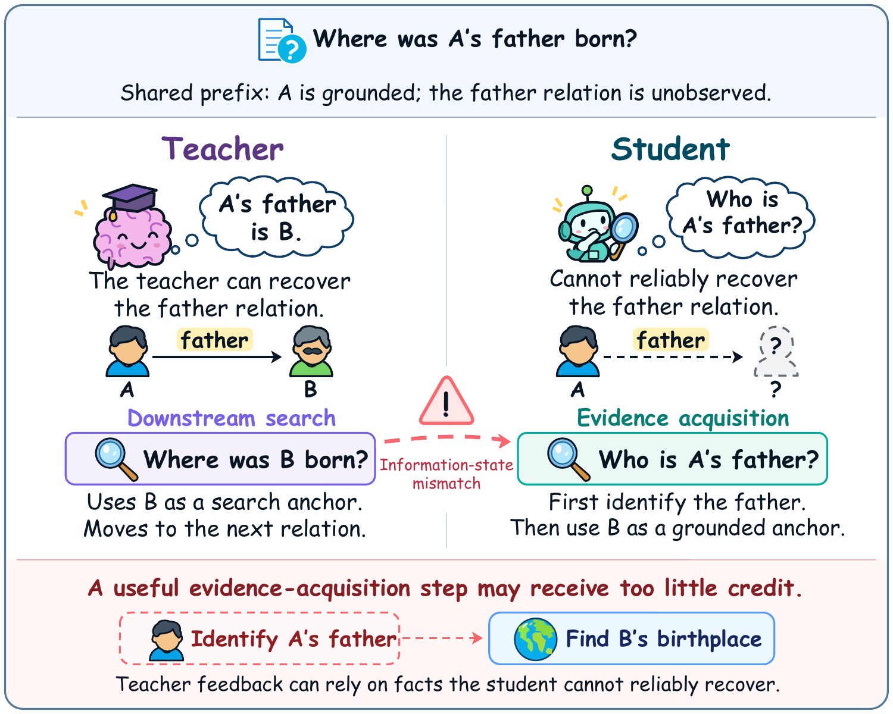
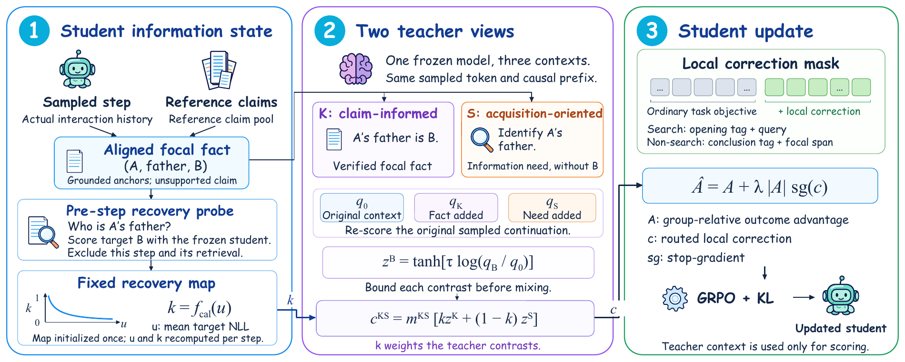

# ISAOPD

**Same Trajectory, Different Knowledge: Information-State-Aware Distillation for Search Agents**

> **Code coming soon.** This repository will host the implementation of ISA-Distill.

## Overview

ISA-Distill adapts on-policy distillation to **what the student can reliably recover from its current information state**.

A teacher may know a fact through its parameters or privileged evidence even when the student cannot recover it. Feedback that assumes this fact is already available can undervalue the search needed to establish it. ISA-Distill addresses this information-state mismatch by allocating supervision between **using a fact** and **acquiring evidence for it**.

  

*Shared trajectories do not ensure shared information states.*

## Framework

  

1. **Estimate factual recoverability.** Probe the student's saved pre-step state for an aligned focal fact. The recovery map is initialized once; the estimate follows the student's evolving knowledge and context.
2. **Weight two teacher views.** Claim-informed feedback supports fact use; acquisition-oriented feedback supports evidence acquisition without revealing the target value. Both re-score the student's original actions.
3. **Apply bounded local corrections.** The weighted feedback modulates outcome-based credit on selected action tokens within a GRPO update. Inference uses only the student and retrieval tool.
